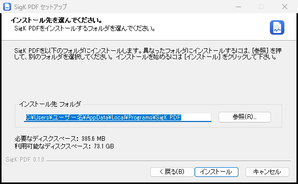
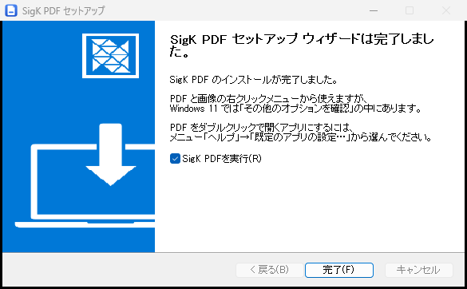
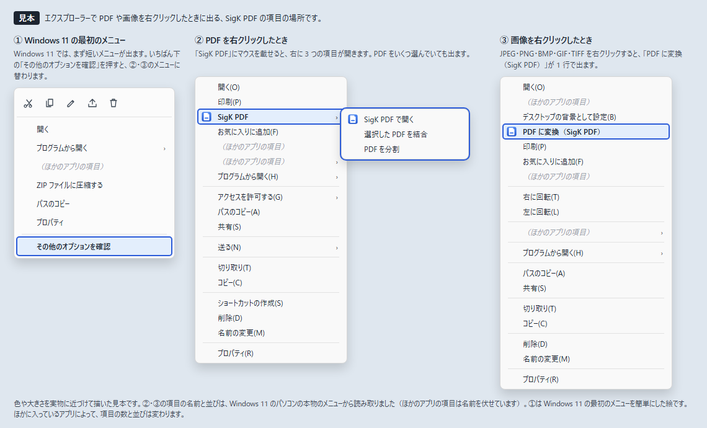
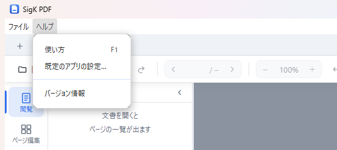
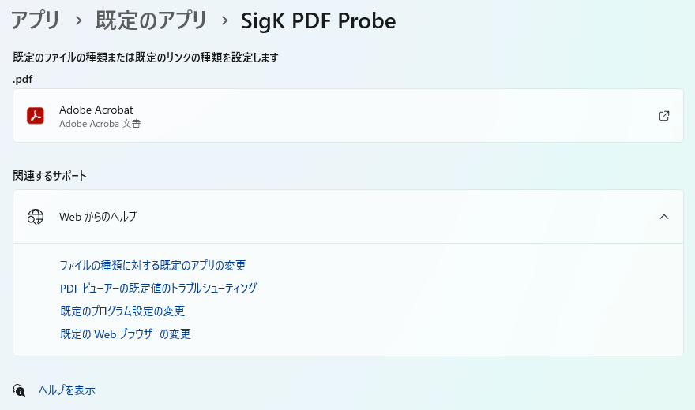

# SigK PDF インストールと使い方ガイド

SigK PDF は、PDF を読む・ページを並べ替える・結合と分割・画像との変換・ハイライトや文字の書き込みを 1 つの画面で行う
Windows のアプリです。このガイドでは、パソコンに入れて使い始めるまでと、新しい版への入れ替え・アンインストールのしかたを説明します。
各機能の操作は、アプリの使い方画面にまとめています（9 章）。

インストーラーとメニュー「ヘルプ」の画像は、Windows 11（25H2）のパソコンで撮りました。右クリックメニューと「設定」の画面の画像は
見本で、それぞれの画像の下に出どころを書いています。Windows の画面の言葉は、Windows の版によって少し違うことがあります。

---

## 1. 動かせるパソコン

| 項目 | 条件 |
|---|---|
| Windows | Windows 10（21H2 以降）か Windows 11。64 ビット版 |
| 空き容量 | 約 390MB（インストーラーの表示は 385.6MB） |
| 管理者の権限 | 要らない（自分のユーザーにだけ入る） |
| インターネット | 要らない（入れるときも使うときも） |

Windows の版と 64 ビット版かどうかは、「設定」→「システム」→「バージョン情報」（Windows 10 では「詳細情報」）で見られます。
Windows 10 のパソコンでは、まだ動きを確かめていません。右クリックメニューの見え方は、4 章のとおり Windows 11 と違う見込みです。

開ける PDF は 1 ファイル 200MB までです。200MB 近い PDF は、1 本開くごとにメモリを 370〜560MB ほど使います（メモリ 16GB のパソコンで、198MB の PDF を
10 本まで同時に開けることと、1 万ページの PDF を 4 秒ほどで開けることを確かめました）。大きな PDF をたくさん開くと動きが遅くなるので、使わないタブは閉じてください。

---

## 2. インストールのしかた

使うのは、配られたインストーラー `SigK PDF Setup 1.2.0.exe` 1 つです。ダブルクリックして始めます。

### 2-1. Windows が青い画面で止めたとき

SigK PDF のインストーラーには、作った人を証明する電子署名を付けていません。そのため、インターネットからダウンロードした
インストーラーなどを開くと、Windows が「Windows によって PC が保護されました」という青い画面を出して止めることがあります。
受け取り方によっては、この画面は出ません。出たときは次の順に進めます。

1. 文の下にある「詳細情報」を押します。
2. 「アプリ」の欄のファイル名が `SigK PDF Setup` で始まり、「発行元」の欄が「不明な発行元」になっていることを確かめます。
   同じファイルを何回かダウンロードすると、名前の後ろに `(1)` などが付くことがあります。
3. 右下に出る［実行］を押します。

受け取った覚えのないファイルのときは、［実行しない］を押して閉じ、配った人に確かめてください。この青い画面の画像はありません。

### 2-2. インストーラーの 3 つのページ

インストーラーは、次の 3 つのページで終わります。インストールの種類（自分だけか、パソコンの全員か）を選ぶページはありません。
管理者の確認（「このアプリがデバイスに変更を加えることを許可しますか？」）も出ません。

**① インストール先のページ**

入れる場所は、ふつうは変えずに［インストール］を押します。初めから入っている場所は、自分のユーザーのフォルダの中の
`C:\Users\（ユーザー名）\AppData\Local\Programs\SigK PDF` です。画像では、欄の中のユーザー名を「ユーザー名」に替えて撮りました（画像は版 0.1.0 のときのもので、左下の版の表示は今の版と違います）。

**② 進み具合のページ**

緑の棒が右へ伸びます。前の版を入れてあったパソコンで新しい版を入れたときは、約 20 秒で次のページに移りました。

**③ 完了のページ**

「SigK PDFを実行(R)」に印が付いたまま［完了］を押すと、SigK PDF が起動します。完了のページの文のとおり、右クリックメニューは
4 章、ダブルクリックで開くアプリにする方法は 5 章で説明します。

インストーラーは、デスクトップとスタートメニューに「SigK PDF」のショートカットを作ります。次からはそこから起動します。

---

## 3. はじめて起動するとき

インストールのすぐあとの 1 回目は、2 回目より起動に時間がかかります。開発に使ったパソコンに 2026 年 10 月 8 日の版を入れて測ると、
ウインドウが表示されるまで 1 回目は約 2 秒、2 回目からは 1〜1.5 秒でした。同じパソコンで、2026 年 9 月の版を作り直した直後に測ったときは、
1 回目に 5〜7 秒かかりました。1 回目が遅いのは、Windows が新しいアプリのファイルを初めて読み込み、ウイルス対策のソフトが中身を
調べるためと見ています。2 回目からは速くなるので、1 回目は待ってください。

---

## 4. 右クリックメニューの使い方

エクスプローラーで PDF や画像を右クリックすると、SigK PDF の項目が出ます。**Windows 11 では、最初に出る短いメニューには
SigK PDF の項目がありません。**いちばん下の「その他のオプションを確認」を押すと、項目の多いメニューに替わり、その中にあります。
Windows 10 では、最初のメニューに出る見込みです。

この画像は見本です。②・③は、Windows 11 のパソコンの本物のメニューの並びを読み取って描きました。①は、Windows 11 の最初の
メニューを簡単にした絵です。ほかに入っているアプリによって、項目の数と並びは変わります。

| 右クリックしたファイル | 項目 | 押したときの動き |
|---|---|---|
| PDF | 「SigK PDF」→「SigK PDF で開く」 | 選んだ PDF をタブで開く。モード切り替えバー（画面の左端の列）で「ツール」を開いているときも、画面は「ツール」のままで、PDF は帯（開いている PDF を 1 つずつ並べた横長の行）として並ぶ |
| PDF | 「SigK PDF」→「選択した PDF を結合」 | モード切り替えバーの「ツール」の「結合」を開き、選んだ PDF をタブ（帯）で開いて、その PDF だけに結合のチェックを入れる（前から開いていた帯のチェックは外れる）。結合は［実行…］を押したときに行う |
| PDF | 「SigK PDF」→「PDF を分割」 | 「ツール」の「分割」を開き、選んだ PDF をタブ（帯）で開いて選択する。選択した帯は、分割画面（ページの間で分割する画面）に広がる |
| 画像（JPEG・PNG・BMP・GIF・TIFF） | 「画像を編集する（SigK PDF）」 | 選んだ画像を 1 つずつタブで開き、モード切り替えバーで「編集」を選択した状態にする。画像に矢印や文字を書き込んで保存できる（9 章「画像に書き込んで保存する」） |
| 画像（JPEG・PNG・BMP・GIF・TIFF） | 「PDF に変換（SigK PDF）」 | 「ツール」の「画像→PDF」を開き、選んだ画像を「変換する画像」の帯（画像を横一列に並べた行）に入れる |

選び方で変わることを、次にまとめます。注意することは、SigK PDF の画面の上の端に出る「通知バー」（細長い 1 行。数秒で消えます）で伝えます。

- **何個選んでも出ます。**16 個以上選ぶと、Windows の「開く」「印刷」などの項目は消えますが、SigK PDF の項目は残ります。
- **1 回の右クリックで選んだファイルは、ファイル名の順に並びます。**数字は数として比べるので、`2.pdf` は `10.pdf` より前に来ます。
  エクスプローラーで更新日時の順などに並べていても、その並びにはなりません。2 つ以上入れたときはファイル名の順に並べたことを知らせるので、
  順番を変更したいときは、結合なら帯の［↑］［↓］で、画像→PDF なら「変換する画像」の帯の画像を横にドラッグして入れ替えます。
- **「変換する画像」の帯に前の画像が残っているときは、その後ろに追加されます。**ただし、［実行…］を押して終えたあとは、新しく選んだ画像に
  入れ替わります。
- **「変換する画像」の帯に入るのは 100 ファイルまでです。**帯に残っていた画像も数に入ります。超えた分は入らず、通知バーで伝えます。
  入らなかったのがどのファイルかは、名前の順の後ろのものとは限りません（Windows がファイルを渡す順番が決まっていないため）。
- **「PDF を分割」は 1 つの PDF だけが対象です。**2 つ以上選んだときは、全部をタブ（帯）で開き、ファイル名の順で先頭の帯を選んで、
  「1つ目のファイルだけを対象にしました。」と知らせます。
- **「画像を編集する（SigK PDF）」で開いたタブは、Windows がファイルを渡した順に並びます。**ファイル名の順に並べ直さないので、
  エクスプローラーの並びと違うことがあります。並び順を変更したいときは、モード切り替えバーで「ツール」を開き、帯の［↑］［↓］で入れ替えます。
- **タブは 20 個まで開けます。**20 個開いているときに「SigK PDF で開く」「選択した PDF を結合」「PDF を分割」「画像を編集する（SigK PDF）」を押すと、新しいファイルはタブで開かずに
  知らせます。タブで開けなかったファイルは、結合にも分割にも入りません（帯が無いため）。
- **PDF と画像を混ぜて選んだときは、右クリックしたファイルの種類の項目だけが出ます。**PDF を右クリックして「選択した PDF を結合」を押すと、
  選んだうち PDF だけが入ります。画像を右クリックして「PDF に変換」を押すと、画像だけが入ります。「画像を編集する」を押したときも、開くのは画像だけです。
- SigK PDF がもう起動しているときは、そのウインドウで開きます。2 つ目のウインドウは開きません。

---

## 5. PDF をダブルクリックで開くアプリにするには

PDF をダブルクリックしたときに開くアプリ（既定のアプリ）は、Windows の決まりで、アプリの側から変えられません。使う人が自分で選びます。
SigK PDF を入れただけでは、今までのアプリ（Adobe Acrobat など）のまま変わりません。

1. SigK PDF のメニュー「ヘルプ」→「既定のアプリの設定…」を押します。

   

2. Windows の「設定」が開き、「アプリ › 既定のアプリ › SigK PDF」のページが出ます。

   

   この画像は、開発中に試しの名前「SigK PDF Probe」で入れたときに撮ったものです。実際には「SigK PDF」と出ます。

3. 「.pdf」の下の欄（現在 PDF を開いているアプリの名前が表示されています）を押します。表示された画面で SigK PDF を選び、［既定値を設定］を
   押して決めます（ボタンの名前は Windows の版によって違うことがあります）。

エクスプローラーからも既定にできます。PDF を右クリックして「プログラムから開く」→「別のプログラムを選択」を押し、表示された画面で SigK PDF を
選んで［常に使う］を押します。「プログラムから開く」の一覧に出ている SigK PDF を押すだけでは、その 1 回だけ SigK PDF で開き、
既定のアプリは変わりません。

元のアプリに戻すときも、同じ手順で元のアプリを選びます。SigK PDF を入れたあと、次に PDF を開いたときに、Windows が開くアプリを
選び直させることがある見込みです。そのときに今までのアプリを選べば、既定のアプリは変わりません。

1 の項目が開くのと同じ設定のアドレスを開くと、Windows 11（25H2）では SigK PDF のページへ直に進むことを確かめました（試しの名前で
入れたもの）。メニューそのものを押す確かめと、Windows 10 での確かめは、まだです。

---

## 6. 新しい版への入れ替え

新しい版のインストーラーを、2 章と同じ手順で入れます。前の版をアンインストールする必要はありません。最近使ったファイルの一覧や
ウインドウの位置などの設定と、右クリックメニューは、そのまま残ります。5 章で SigK PDF を既定のアプリに選んでいた場合も、その選択は残る見込みです。

**入れ替える前に、SigK PDF を閉じてください。**保存していない変更があれば、先に保存します。開いたままインストーラーを動かすと、
「SigK PDF が起動しています。OKをクリックして、閉じてください。閉じない場合は、手動で閉じてください。」という画面が表示されます。
［OK］を押すと SigK PDF が閉じられ、保存していない変更は消えます。

---

## 7. アンインストールのしかた

**始める前に、SigK PDF を閉じてください**（6 章と同じ画面が表示され、保存していない変更が消えるため）。

1. Windows の「設定」→「アプリ」→「インストールされているアプリ」を開きます。
2. 一覧の「SigK PDF 1.2.0」の右の「…」を押し、「アンインストール」を押します。小さな確認画面が表示されたら、もう一度「アンインストール」を
   押します。
3. SigK PDF のアンインストール画面が表示されたら、ボタンを押して進め、最後に［完了］を押します。

Windows 10 では、「設定」→「アプリ」→「アプリと機能」を開き、一覧の「SigK PDF 1.2.0」を押すと出る［アンインストール］を押します。

アンインストールで消えるのは、SigK PDF の本体、デスクトップとスタートメニューのショートカット、右クリックメニューの項目、
「プログラムから開く」の一覧の SigK PDF です。SigK PDF で保存した PDF は消えません。

**設定は残ります。**最近使ったファイルの一覧・ウインドウの位置・書き込みの色（最近使用した色を含む）や作成者名・エラーログ（8 章）は、`%APPDATA%\SigK PDF` の
フォルダに残り、入れ直すとそのまま使えます。すっかり消したいときは、エクスプローラーのアドレス欄に `%APPDATA%` と打って Enter を押し、
出てきた中の「SigK PDF」のフォルダを削除します。

SigK PDF を既定のアプリにしていた場合は、アンインストールのあと、PDF の既定のアプリが無い状態になる見込みです。次に PDF を開くと、
Windows がどのアプリで開くかを聞いてくるので、使うアプリを選んでください。SigK PDF の側から、前に使っていたアプリへ戻すことはできません。

---

## 8. 困ったとき

| 困ったこと | 見るところ・すること |
|---|---|
| 右クリックしても SigK PDF の項目が無い | Windows 11 では「その他のオプションを確認」の中にある（4 章） |
| 起動が遅い | インストールのすぐあとの 1 回目は、2 回目より時間がかかる（3 章） |
| 結合や画像→PDF に、選んだファイルが全部入らない | 結合に入るのは、タブ（帯）で開けた PDF だけで、タブは 20 個まで。「変換する画像」の帯に入るのは、残っていた分も含めて 100 ファイルまで。混ぜて選んだときは、右クリックしたファイルの種類だけが入る（4 章） |
| 右クリックで送ったファイルが、すぐに入らない | SigK PDF で確認画面や保存画面が開いている間は、入るのを待つ。画面を閉じると入る |
| 開いた PDF を保存できない | パスワードで保護された PDF は、読めるが保存できない（開くときにパスワードを聞かれない、所有者のパスワードだけで保護された PDF も同じ）。ツールが結合などを実行している間と、別の保存をしている間も保存できないので、終わるのを待つ |
| PDF を開けない | 「PDF として読み込めませんでした」は、ファイルが壊れているか、中身が PDF でない。「N ページ目が壊れているので」は、そのページが壊れているので文書全体を開かない（壊れたページを抜いて使うと、欠けたことに気づけないため）。200MB を超える PDF は開けない |
| 動きが遅い | 大きな PDF をたくさん開くと、メモリを多く使う（1 章）。使わないタブを閉じる |
| 保存画面が、いつも元のファイルのフォルダで開く | 設定画面の「書き出し先フォルダ（初期値）」で、「最後に書き出したフォルダ」か「指定フォルダ」を選択する（9 章） |
| PDF のダブルクリックで SigK PDF が開かない | 既定のアプリを選んでいない（5 章） |
| JPEG の画像を開けない | プログレッシブ形式の JPEG は開けない。ほかのアプリで、プログレッシブではない形式で保存し直してから開く |
| 画像の書き込みを、保存したあとで直せない | 画像の［上書き保存］は、書き込みを画像に焼き込む。あとで直したいときは、［名前を付けて保存］で PDF を選んで保存する（9 章） |
| SigK PDF の版を知りたい | メニュー「ヘルプ」→「バージョン情報」 |

うまく動作しないときは、エラーログが `%APPDATA%\SigK PDF\logs` のフォルダの `error.log` に残ります。メニュー「ヘルプ」→
「エラーログフォルダを開く」を押すと、エクスプローラーでこのフォルダが開きます（エクスプローラーのアドレス欄に `%APPDATA%\SigK PDF\logs` と打って Enter を押しても開けます）。配った人に相談するときは、このファイルを渡すと原因を
調べやすくなります。ログには開いたファイルの場所と名前が入るので、渡す前に中身を確かめてください。

---

## 9. 各機能の使い方

ボタンやファイル名にマウスカーソルを合わせて 0.5 秒ほど待つと、名前・機能・キーを記載したツールチップが表示されます。

結合・分割・変換・書き込みなど、各機能の操作は、アプリの使い方画面に書いてあります。次のどれかで開きます。

- ツールバーの右端の「？」を押す
- F1 キーを押す
- メニュー「ヘルプ」→「使い方」を押す

使い方画面の左の目次から、知りたい機能を選びます。使い方画面は、そのとき使っているモード（モード切り替えバーの「閲覧」「ページ編集」「編集」
「ツール」のどれか）の説明を表示して開きます。

### 画像に書き込んで保存する

PNG・JPEG・BMP・GIF・TIFF の画像も、PDF と同じくツールバーの［開く］で開けます。ウインドウへドロップしても開けます（ツールモードでドロップしたときは、
「ツール」の「画像→PDF」に入ります）。エクスプローラーで画像を右クリックし、「画像を編集する（SigK PDF）」を押しても開けます（4 章）。
このときは、モード切り替えバーで「編集」を選択した状態で開きます。次に SigK PDF を起動したときも、「編集」を選んだ状態で始まります。
スマートフォンなどで撮った写真（JPEG）は、写真に入っている向きの情報を読んで、エクスプローラーと同じ向きで開きます。
「ツール」の「画像→PDF」と、ページの差し込みでも、写真はエクスプローラーと同じ向きで PDF に載ります（左右反転などの、鏡に映した向きを除きます）。

開いた画像には、編集モードの書き込みツールで矢印・四角・文字などを書き込めます。トリミングの右の［左回転］［右回転］を押すと、画像が 90° 回ります。画像には選べる文字が無いので、ハイライト・下線・取り消し線は使えません。
ノートも、画像に保存すると付箋の本文が残らないので使えません。

［上書き保存］を押すと、書き込みを画像に焼き込んで、元と同じ形式で保存します。保存後は書き込みを移動・編集できないので、保存前に
確認画面が表示されます。確認画面で「次回から表示しない」にチェックを付けて保存すると、次回からは確認画面を表示せずに保存します。もう一度表示するには、
設定画面の「画像を上書き保存する前に確認画面を表示する」にチェックを付けます。設定画面でバックアップファイルを作成する設定にしていれば、元の画像は
「名前.png.bak」のようなバックアップファイルに残ります（初期状態では作成しません）。BMP・GIF・TIFF は同じ形式で保存できないので、［名前を付けて保存］の画面が表示されます。

［名前を付けて保存］では、PNG・JPEG・PDF から選べます。あとで書き込みを直したいときは、PDF を選んでください。PDF では、書き込みが
書き込みのまま残ります。

### 空のタブと、クリップボードの画像の貼り付け

タブバー（開いているファイルのタブが並ぶ行）の右端の「＋」を押すと、空のタブ（タブ名「新しいタブ」）が開きます。閲覧・ページ編集・編集のどのモードでも同じです。
空のタブの中央には、［ファイルを開く］ボタンと、「最近使ったファイル」の一覧が表示されます。

- ［ファイルを開く］を押すと、ツールバーの［開く］と同じ画面が表示されます。選んだファイルは、空のタブの位置で開きます。ツールバーの［開く］・
  Ctrl＋O・ドロップ・「最近使ったファイル」で開いたときも同じです。
- 空のタブは 1 つだけ開けます。空のタブがあるときに「＋」を押すと、その空のタブに切り替わります。
- 空のタブを表示しているときに Ctrl＋V を押すと、クリップボードの画像（Windows キー＋Shift＋S で切り取った画面や、ブラウザーの「画像をコピー」で
  コピーした画像など）が、空のタブの位置に「新しい画像 1」という名前で開きます。続けて貼り付けると「新しい画像 2」「新しい画像 3」となります
  （アプリを起動し直すと 1 に戻ります）。クリップボードに画像が無いときは、画面の上の通知バーに「クリップボードに画像がありません。」と表示されます。
  エクスプローラーでコピーした画像ファイルは貼り付けられないので、［ファイルを開く］かドロップで開いてください。
- 貼り付けた画像には、編集モードで書き込めます（「画像に書き込んで保存する」と同じ）。まだファイルになっていないので、［上書き保存］を押しても
  ［名前を付けて保存］の画面が表示されます。形式は PNG・JPEG・PDF から選べ、初めは PNG で「新しい画像 1.png」が入っています。保存すると、
  タブ名が保存したファイルの名前に変わります。保存しないまま閉じようとすると、保存するかどうかを聞く確認画面が表示されます。

### 表示倍率

- 文書を開くと、100% で表示します。画像は、100% でウインドウに収まらないときだけ、［全体］（ページ全体をウインドウに収める倍率）で表示します。
- ツールバーの［－］［＋］、Ctrl＋－／＋ キー、Ctrl キーを押しながらマウスのホイールを回す操作で、倍率が 1 段階ずつ変わります。
  33% から 100% までは、33・40・50・60・70・80・90・100% の段階です。
- ツールバーの倍率の数字をクリックすると、倍率を入力できます。数字を入力して Enter キーを押すと、その倍率で表示します。Esc キーで入力を取り消します。
- ツールモードの帯の倍率は、閲覧の倍率とは別です（50〜300%）。100% は、2026-11-13 に変更する前の 200% と同じ大きさです。

### ページのコピー・切り取り・削除

ツールモードの帯のページと、ページ編集モード・編集モードの左パネルのサムネイルでは、ページを右クリックすると、
［コピー］［切り取り］［貼り付け］［削除］のメニューが表示されます。

- ページは、クリック・Ctrl＋クリック・Shift＋クリックで選択します。編集モードのサムネイルも、ページ編集モードと同じく選択でき、ドラッグで並べ替えられます。
- 選択していないページを右クリックすると、そのページだけを選択します。選択したページの上で右クリックすると、選択したページすべてが対象になります。
- ［貼り付け］を押すと、コピー・切り取りしたページを、右クリックしたページの前に貼り付けます。ページの無い所（帯のページの右・サムネイルの下）を
  右クリックしたときは、末尾に貼り付けます。ほかの帯（タブ）にも貼り付けられます。
- 帯のページか左パネルのサムネイルをクリックした後は、キーでも操作できます。Delete で削除、Ctrl+C でコピー、Ctrl+X で切り取り、Ctrl+V で貼り付けます。
  Ctrl+V は、選択したページの前に貼り付けます（何も選択していなければ末尾に貼り付けます）。
- 削除する前に、確認画面が表示されます。［削除］を押すと削除します。ページ編集モードの［削除］ボタンも同じです。［切り取り］では確認画面を表示しません。
- 削除・切り取り・貼り付けは、［元に戻す］（Ctrl+Z）で戻せます。
- 貼り付けたページには、上書き保存してもう一度開くまで、書き込み・トリミング・モザイクを追加できません。
- コピーしたページは SigK PDF の中だけで使えます。ほかのアプリには貼り付けられず、SigK PDF を終了すると消えます。
- パスワード付きの PDF のページと、保存していないモザイクがあるページは、コピー・切り取りできません。ツールモードで「分割」を選んでいる間は、
  右クリックメニューとキー操作を使えません。

### 印刷

ツールバーの印刷ボタン（［開く］のすぐ右の、プリンターのアイコンと「印刷」の文字のボタン）か Ctrl＋P で、印刷画面を開きます。印刷画面は、Acrobat Reader の［印刷］ダイアログと同じ構成です。

- プリンター(N) の一覧で、印刷するプリンターを選びます。最初は Windows の既定のプリンターです。用紙サイズ・両面・カラーの初期値は、選んだプリンターの
  Windows の設定から取得します。
- ［プロパティ(P)］を押すと、プリンターの印刷設定が開きます。ここで変更した設定はプリンターの既定として残り、ほかのアプリの印刷にも反映されます。
  手差しなどのトレイを使うときは、ここで給紙方法を変更します（［ページ設定(S)...］の給紙方法は「自動」だけです）。［詳細設定(D)］は使えません。
- 印刷するページは、すべて(A)・現在のページ(U)・ページ指定(G)（例 1-5, 8）から選びます。詳細オプションを開くと、現在の表示範囲(V)・逆順に印刷(E)・
  偶数または奇数ページも選べます。一度に印刷できるのは 100 ページまでです。
- ページサイズ処理は、［サイズ(I)］［ポスター］［複数］［小冊子］から選びます。ⓘ を押すと説明が表示されます。
  - サイズ: 合わせる(F)（用紙に収まる大きさ）・実際のサイズ・特大ページを縮小・カスタム倍率から選びます。
  - ポスター: 1 ページを拡大して、複数の用紙に分けて印刷します。タイルマーク(K) とラベルを付けると、貼り合わせる位置が分かります。
  - 複数: 1 枚の用紙に、2・4・6・9・16 ページか、列と行で指定した数のページを並べます。
  - 小冊子: 二つ折りにすると冊子になる順番で、用紙の両面に印刷します。
- 右のプレビューで、用紙 1 枚ごとの印刷結果を確認できます。［<］［>］とスライダーで用紙を切り替えます。
- 注釈とフォーム(M) が「文書と注釈」のときは、保存していない書き込みも印刷されます。「文書」を選ぶと、書き込みを印刷しません。
- インク / トナーを節約にチェックを付けると、色を 15% 薄くして印刷します。
- ［印刷］を押すと印刷画面が閉じ、進行状況画面が表示されます。印刷できなかったときは、通知バーに理由が表示されます。

### 設定画面

メニュー「ファイル」→「設定…」（Ctrl＋,）か、ツールバーの右端にある歯車ボタン（「？」の左）で開きます。［OK］を押すと設定を変更し、
［キャンセル］か Esc キーで、変更せずに閉じます。

| 設定 | 初期値 | 内容 |
|---|---|---|
| 書き出し先フォルダ（初期値） | 元のファイルと同じフォルダ | 保存画面で最初に表示されるフォルダと、分割・画像→PDF・PDF→画像の設定パネルにある「フォルダ」の初期値です。「最後に書き出したフォルダ」「指定フォルダ」も選択できます。「最後に書き出したフォルダ」か「指定フォルダ」が見つからないときは、元のファイルと同じフォルダを使用します |
| 上書き保存する前に、元のファイルのバックアップファイル（名前.pdf.bak）を作成する | 作成しない | チェックを付けると、上書き保存する前に元のファイルを残します。チェックを外しても、既存のバックアップファイルは削除しません。版 1.2.0 で、初期値を「作成しない」に変更しました（前の版で「作成する」にしていても、チェックが外れた状態になります） |
| 画像を上書き保存する前に確認画面を表示する | 表示する | 確認画面で「次回から表示しない」にチェックを付けて保存すると、チェックが外れます |
| ツールで選択した値を記憶し、次回起動時にも使用する | 記憶する | 透かしの種類・文字・色・不透明度・角度・大きさ・位置、PDF→画像の形式・解像度、画像→PDF の用紙・向き・余白・出力方式、分割のファイル名形式、フラット化の焼き込む書き込みの種類。ページ範囲と、透かしに使う画像ファイルは記憶しません |
| 最後に使用したツールを記憶し、次回ツールモードを開いたときに選択した状態にする | 記憶する | 右クリックの「PDF を分割」などから開いたときは、そちらを選択します |

設定画面の「既定のアプリ」の節にある［Windows の設定を開く］は、メニュー「ヘルプ」→「既定のアプリの設定…」と同じ所を開きます（5 章）。
